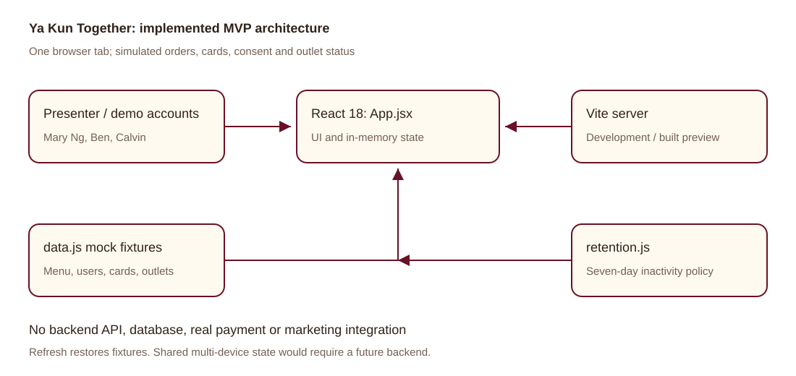

# Ya Kun Together — SC4025 project

A React/Vite presentation MVP for group ordering. Mary Ng organises the group. Participants choose their own food, confirm their own mock cards and earn personal Cherish points after collection.

The [documentation index](docs/README.md) provides links to architecture, implemented features, testing and report screenshots.

## Prerequisites

- Git to clone the repository.
- Node.js and npm to install dependencies and run the app.
- A web browser to view the prototype.

The production build, collection tests and mock-data checks have been verified with Node.js **24.22.1**. The direct Node commands below are available when dependencies are already installed. npm is required for the standard dependency installation step.

## Start the app

For a fresh copy:

```sh
git clone https://github.com/joeyleonggg/SC4025-Project.git
cd SC4025-Project
```

From the repository folder:

```sh
cd frontend
npm install
npm run dev
```

Open the local address printed by the terminal. Keep that terminal running. Stop it with Ctrl+C. There is no separate backend to start.

With the existing dependencies, these direct Node commands also work when npm is unavailable:

```sh
cd frontend
node node_modules/vite/bin/vite.js --host 127.0.0.1 --port 5173 --strictPort
```

For a built preview:

```sh
npm run build
npm run preview
```

If the site cannot be reached, restart the server and use the exact address/port shown by its terminal. A closed terminal stops the local site.

## Demo accounts

All accounts use password **kaya1234**.

| Person | Email | Role | Default / alternative card endings |
| --- | --- | --- | --- |
| Mary Ng | maryng@yakun.demo | Organiser | 1111 / 8008 |
| Ben | ben@yakun.demo | Participant | 2222 / 8018 |
| Calvin | calvin@yakun.demo | Participant | 3333 / 8028 |

After signing in, use the name at the top right to switch users and open demo controls. Those controls simulate deadline expiry, unavailable Milo, a full collection slot, declined cards, outlet progress and retention expiry.

Everything is simulated in the current browser tab. Refresh restores fixtures. Invitation links open against this same running tab. Another device or a fresh tab has no shared group data.

## Current behaviour

| Area | Implemented behaviour |
| --- | --- |
| Group setup | Expected capacity 2–10, never below joined membership. Countdown and one full 15-minute extension |
| Invitations | Mary invites named accounts. Each participant presses Join group. Saved groups send pending invitations to their listed members |
| Menu | 74 items, six categories, 73 supplied screenshot pictures, set-drink supplements, sweetness and quantities |
| Editing | Carts remain drafts until Submit my order / Update my order. Participants cannot change someone else's items |
| Payment | Individual payments only for new orders. Two saved mock cards per account. No charge until a successful send |
| Recovery | A decline leaves everyone uncharged. The affected person confirms the alternative card, then Mary retries. Duplicate sends cannot charge twice |
| Privacy | Mary sees payment status without other people's card details. Participants see their own cards, failures, reminders and receipts |
| Collection | Pickup has ASAP, three quick choices and a later dropdown. Advance mode reserves two hours beyond the planned deadline. Sending rechecks timing/capacity/stock and locks the selection |
| Extension | One extension per group. Collection stays fixed. Original advance qualification is retained through that extended deadline. A changed time must qualify afresh |
| Points | Pickup: floor(personal payment after rewards × 8). Qualifying advance: floor(payment × 8 × 1.1). Round down once. A $6.30 payment earns 50 or 55 points. Credit once at collection |
| Reminders | At two minutes remaining, target each joined person's missing order or card. Closing early checks missing cards immediately. No duplicate automatic reminder for that person/kind/deadline |
| Consent | Joining disclosure plus separate marketing opt-in, unticked by default. Review/withdraw under More → Privacy and data. No marketing is sent |
| Retention | Seven inactive days for completed history and saved groups. Leaving clears active data and related saved membership. Earlier receipts and unrelated records are preserved until expiry |
| Reuse | Owner-managed saved groups, rename/reuse and history reordering at current prices. Old receipts keep their recorded values |

The full consolidation and who-gets-what view appears after sending. The verification document explains order publication, the deadline-extension exception and the points-rounding policy.

## Test and demonstrate

Start with the [complete manual test guide](docs/testing-guide.md). It includes the exact actions and expected totals/points, plus short error/recovery tests.

From frontend:

```sh
npm run test:collection
npm run build
npm run check:mock
```

Direct equivalents when dependencies are already installed:

```sh
node --test tests/collection-flow.test.mjs
node node_modules/vite/bin/vite.js build
node scripts/export-mock-data.mjs --check
```

The controlled-clock checks cover multi-hour timing, reminders and seven-day expiry without real waits. See [functional verification](docs/acceptance/report-alignment.md) for coverage, implementation rules and prototype limitations.

## Repository layout

```text
SC4025-Project/
├── README.md                 Project overview, setup and demo accounts
├── frontend/
│   ├── src/                  React screens, state, fixtures and styles
│   ├── public/menu/          Menu pictures used by the app
│   ├── tests/                Collection flow and controlled-clock tests
│   ├── scripts/              Mock-data export and consistency checks
│   ├── package.json          Dependencies and application commands
│   └── package-lock.json     Recorded dependency versions
├── backend/
│   ├── README.md             Scope of the simulated backend
│   └── mock-data/            Generated reference snapshots
├── docs/
│   ├── README.md             Documentation index
│   ├── architecture/         Architecture explanation and diagram
│   ├── acceptance/           Verification evidence and behaviour rules
│   ├── improvements/         Implemented feature details and checks
│   ├── report/               Screenshot catalogue and report assets
│   └── testing-guide.md      Manual demonstration and recovery tests
├── scripts/                  Repository documentation link checker
└── .gitignore                Dependency, build and environment exclusions
```

Application source and tests are in frontend. The backend folder contains reference data and documentation, with no separate service to start. The [documentation index](docs/README.md) explains where to find each supporting reference.

## Report and repository references

### System architecture

The [dedicated architecture folder](docs/architecture/README.md) explains the implemented components, state transitions and service boundaries. Its [diagram](docs/architecture/architecture.svg) is available for the report. The browser holds application state. The Vite server serves the frontend rather than processing orders. The backend folder contains reference fixtures and documentation, with no running backend API.



### Technology stack

Versions below are recorded in frontend/package-lock.json. They describe this MVP rather than a proposed production deployment.

| Technology | Version or source | Role in this project |
| --- | --- | --- |
| React and React DOM | 18.3.1 | Components, account-specific views and in-memory application state |
| Vite | 5.4.21 | Local development server and production asset build |
| React plugin for Vite | 4.7.0 | JSX transformation and development refresh |
| JavaScript and JSX | frontend/src | Order, payment, invitation, points and retention behaviour |
| CSS and static images | Frontend styles and public/menu | Phone-style layout and supplied menu pictures |
| Node.js built-in test runner | node:test | Controlled-state and clock tests for the collection flow |
| JSON reference snapshots | backend/mock-data | Exported examples generated from the frontend fixtures |

There is no additional UI framework, database, backend API or real payment integration in the current app. [Backend documentation](backend/README.md) explains this boundary, and the demo account table above supplies the presentation logins.

React provides reusable components and state-driven updates for the organiser and participant views. Vite supplies local development and production builds. Plain CSS controls the phone-style layout, while local fixtures make the presentation reproducible without external services. The built-in Node.js test runner checks the order rules and timing boundaries without requiring a live payment provider or outlet.

The main implementation files are [main.jsx](frontend/src/main.jsx) for application startup, [App.jsx](frontend/src/App.jsx) for screens and order logic, [data.js](frontend/src/data.js) for fixtures, [retention.js](frontend/src/retention.js) for expiry helpers and [styles.css](frontend/src/styles.css) for presentation. [package.json](frontend/package.json) declares dependencies and commands, and [package-lock.json](frontend/package-lock.json) records the resolved versions.

### Report assets

- [Implemented architecture and technology](docs/architecture/README.md), with [an insertable SVG diagram](docs/architecture/architecture.svg).
- [Backend boundary](backend/README.md) and [generated mock-data reference](backend/mock-data/README.md). The running application uses frontend/src/data.js. Export reference snapshots with npm run export:mock after changing fixtures.
- [Section 4.5 screen captures and captions](docs/report/4.5-wireframes.md).
- [Functional verification and implementation rules](docs/acceptance/report-alignment.md).
- [Menu prices, picture sources and pricing estimates](docs/improvements/03-menu-catalogue.md).
- [Pickup rules](docs/improvements/04-pickup-times.md), [extension](docs/improvements/05-deadline-extension.md), [bonus](docs/improvements/06-advance-points.md), [card recovery](docs/improvements/07-payment-recovery.md), [privacy](docs/improvements/08-payment-privacy.md), [invitations](docs/improvements/09-invitations.md), [reminders](docs/improvements/10-automatic-reminders.md), [consent](docs/improvements/11-joining-consent.md) and [retention](docs/improvements/12-retention.md).

New orders use individual payments, and points depend on personal spending and collection mode rather than group size. Historical receipts retain their recorded payments and awards. Some menu prices and supplements are estimates, as detailed in the menu catalogue documentation. Outlet capacities are mock data. Opening hours and real payments are outside this MVP.
