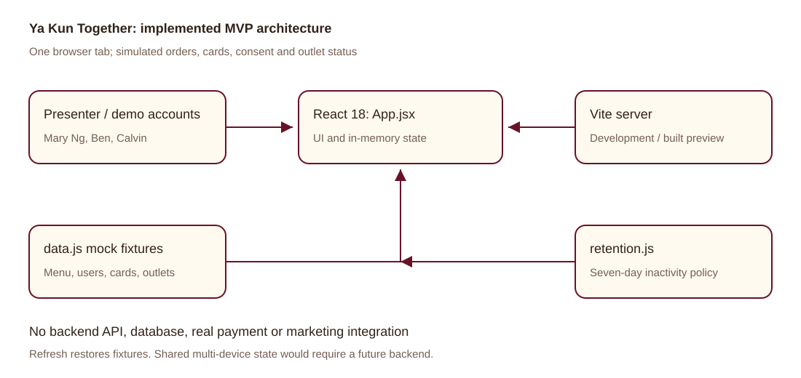
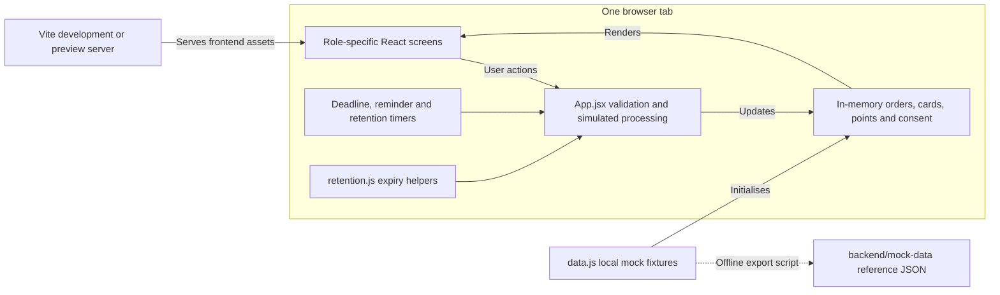

# Implemented MVP architecture

This folder describes the implemented architecture of the Ya Kun Together MVP. The application runs in one browser tab, with React handling the interface and simulated order processing. Vite serves the frontend files. There is no separate backend API or database in this prototype. The [repository README](../../README.md#technology-stack) documents the technology stack and setup instructions.

## Architecture diagram

The diagram shows the implemented system. Data enters the React application from local fixtures, user actions update browser memory, and the interface displays the resulting state. The Vite server supplies frontend assets and does not process payments or group orders.

## Application and data flow

The dotted export connection is a development operation, not a browser request. The application reads its fixtures from `frontend/src/data.js`. It does not load the exported JSON as a separate service.

## Components and boundaries

- React 18 handles the phone-frame UI. The installed build uses React 18.3.1 and Vite 5.4.21. Package.json declares compatible React 18 / Vite 5 ranges.
- App.jsx owns role views, drafts versus submitted orders, invitation access, simulated cards/declines/charges, points, consent and notifications.
- data.js is the canonical menu/account/outlet fixture source. Pictures are supplied screenshot crops under frontend/public/menu.
- retention.js supplies seven-day expiry helpers. React timers run reminders, closure and retention while the tab is open.
- backend/ holds documentation and exported reference fixtures. There is no backend API, database, real authentication, payment gateway or marketing service.
- Refresh restores fixtures. This reset is separate from inactivity expiry. Invitation links resolve against state in the same running tab.

## Component responsibilities

| Component | Responsibility |
| --- | --- |
| [main.jsx](../../frontend/src/main.jsx) | Mounts the React application in the browser |
| [App.jsx](../../frontend/src/App.jsx) | Renders role-specific screens and processes group setup, invitations, submitted orders, simulated payments, points and notifications |
| [data.js](../../frontend/src/data.js) | Supplies menu items, demo accounts, saved mock cards, outlets and sample history |
| [retention.js](../../frontend/src/retention.js) | Calculates inactivity expiry and supports scoped data cleanup |
| [styles.css](../../frontend/src/styles.css) | Defines the phone-style layout, screen components and feedback presentation |
| [public/menu](../../frontend/public/menu) | Stores the menu image references used by the catalogue |
| [backend](../../backend/README.md) | Documents the simulated service boundary and contains generated reference fixtures |

## Example order flow

1. Mary creates a group and invites named demo accounts. The application stores the group and pending invitations in browser memory.
2. Each participant joins, edits a personal cart and submits it. Draft changes remain separate until Submit my order or Update my order publishes them.
3. Each participant confirms a saved mock card. Confirmation records readiness without charging it.
4. Mary sends the group order. The application validates collection time, capacity, item availability and payment readiness. A simulated decline leaves the group unsent and everyone uncharged.
5. A successful send records each personal payment and shows the combined outlet order. Demo controls simulate outlet progress to ready for collection.
6. Collection credits personal points once and records the completed order in history. Saved groups and history use the seven-day inactivity policy.

All six steps execute locally. No order or card details are transmitted to a real outlet or payment provider.

## Backend boundary

The backend responsibilities in a deployed ordering service would include shared storage, account verification, payment processing and outlet communication. In this MVP, local React logic and fixtures simulate those responsibilities. The `backend/` directory is a documentation and reference-data folder, not a running server.

Consequently, refreshing restores the fixtures and separate tabs or devices do not share live orders. The prototype demonstrates the interaction and business rules within one session. It does not demonstrate production integration or durable storage.

## Main state transitions

Create → invite named accounts → each participant joins → edit own cart → Submit/Update my order → confirm own card → organiser closes → validate/send → preparing → ready → collected → personal points/history.

A decline leaves everyone uncharged and requires another card. Cancellation stops sending. One full 15-minute extension preserves original advance status for the same collection time through the extended deadline. Sending fixes the bonus. Collection credits points once.

## Validation

[Automated checks](../../frontend/tests/collection-flow.test.mjs) execute actual App handlers with controlled React state. Timer cases run real effects with a controlled clock. Browser walkthroughs additionally inspect layout and actual clicks. [Acceptance results](../acceptance/report-alignment.md) record coverage, implementation rules and prototype limitations.
