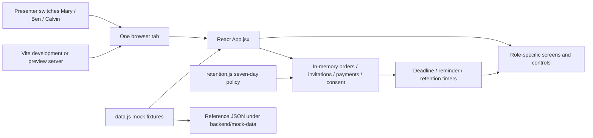

# Implemented MVP architecture

This dedicated folder supplies the architecture reference requested for the report. The repository README supplies the technology/setup reference.

## Components and boundaries

- React 18 handles the phone-frame UI. The installed build uses React 18.3.1 and Vite 5.4.21; package.json declares compatible React 18 / Vite 5 ranges.
- App.jsx owns role views, drafts versus submitted orders, invitation access, simulated cards/declines/charges, points, consent and notifications.
- data.js is the canonical menu/account/outlet fixture source. Pictures are supplied screenshot crops under frontend/public/menu.
- retention.js supplies seven-day expiry helpers. React timers run reminders, closure and retention while the tab is open.
- backend/ holds documentation and exported reference fixtures. There is no backend API, database, real authentication, payment gateway or marketing service.
- Refresh restores fixtures. This reset is separate from inactivity expiry. Invitation links resolve against state in the same running tab.

## Main state transitions

Create → invite named accounts → each participant joins → edit own cart → Submit/Update my order → confirm own card → organiser closes → validate/send → preparing → ready → collected → personal points/history.

A decline leaves everyone uncharged and requires another card. Cancellation stops sending. One full 15-minute extension preserves original advance status for the same collection time through the extended deadline. Sending fixes the bonus; collection credits points once.

## Validation

[Automated checks](../../frontend/tests/collection-flow.test.mjs) execute actual App handlers with controlled React state. Timer cases run real effects with a controlled clock. Browser walkthroughs additionally inspect layout and actual clicks. [Acceptance results](../acceptance/report-alignment.md) record coverage and agreed report differences.
