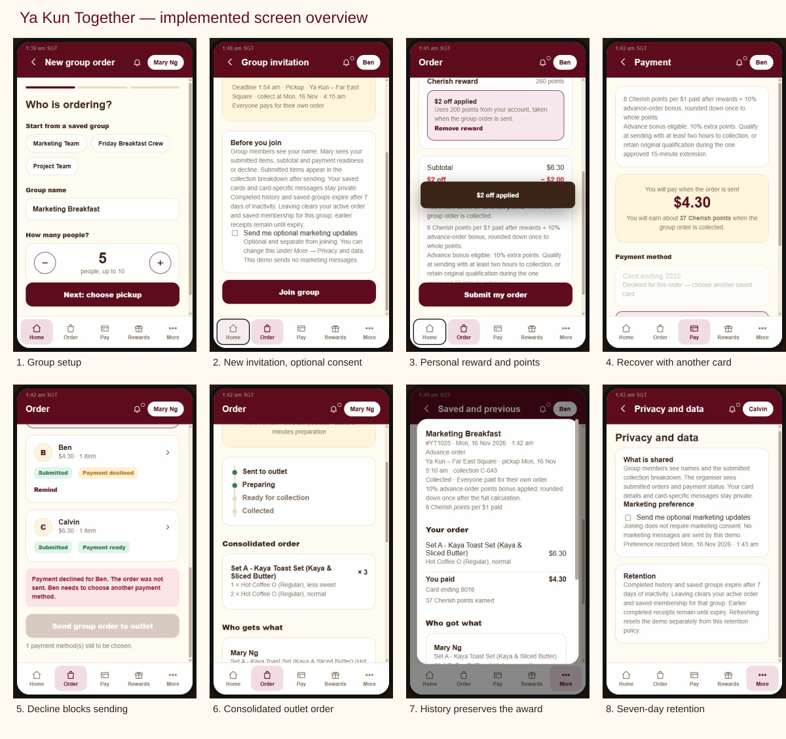

# Section 4.5 — implemented wireframes and screen explanations

These captures document the implemented prototype. The overview illustrates the main screens. Each source image is also available at full resolution. Captures are from 16 November 2026.

## Suggested report text

The prototype supports Mary Ng as organiser and individual team members as participants. Group setup establishes expected capacity, collection mode and ordering time. Named invitations require each participant to join. The joining disclosure explains information sharing and presents optional marketing consent separately. Each participant customises and confirms their own order and saved payment method. The organiser monitors readiness and handles exceptions before sending one consolidated outlet order. Collection credits personal points, while history preserves each recorded payment and award. Privacy preferences and the seven-day inactivity policy are available under More.

The full combined-quantity and who-gets-what screen appears after sending. Draft edits require Update my order. Advance qualification is preserved during one 15-minute deadline extension. The verification document describes these implementation rules.

## Figure captions and source images

| Figure | Screen and requirement | Caption |
| --- | --- | --- |
| 4.5.1 | [Organiser home](screens/01-home.jpg) — FR-01 / FR-02 | Mary Ng starts a team order. Each participant pays for their own items. |
| 4.5.2 | [Group setup](screens/02-group-setup.jpg) — FR-01 / FR-07 | Name the group and choose an expected capacity between two and ten. |
| 4.5.3 | [Advance collection](screens/03-advance-collection.jpg) — FR-07 | Advance choices reserve at least two hours after the planned ordering deadline. |
| 4.5.4 | [Ordering time and payment](screens/04-payment-rule.jpg) — FR-01 / FR-05 | Thirty minutes to order. Every person confirms their own saved card. No charge happens yet. |
| 4.5.5 | [Pending invitations](screens/05-pending-invitations.jpg) — FR-01 / FR-11 | Ben and Calvin are invited, but the joined-member count remains one until they accept. |
| 4.5.6 | [Joining notice and consent](screens/06-joining-notice.jpg) — Governance / FR-11 | Ben reads the disclosure. Marketing consent is separate and starts unticked. Joining does not require it. |
| 4.5.7 | [Menu and personal choices](screens/07-menu.jpg) — FR-03 | The menu contains food pictures, categories, current prices and customisable set drinks. |
| 4.5.8 | [Customise an item](screens/08-customisation.jpg) — FR-03 | Choose the set drink, sweetness and quantity. Supplements are included in the total. |
| 4.5.9 | [Personal reward and points](screens/09-personal-reward.jpg) — FR-06 | Ben redeems 200 points for two dollars off: he pays $4.30 and estimates 37 advance points. |
| 4.5.10 | [Personal saved cards](screens/10-saved-cards.jpg) — FR-05 | Ben confirms his own card. Card selection does not charge it. Charging waits for a successful send. |
| 4.5.11 | [Individual customisation](screens/11-sweetness-choice.jpg) — FR-03 / FR-04 | Mary selects less sweet without changing the default set price. Each person edits only their own cart. |
| 4.5.12 | [Organiser review](screens/12-organiser-status.jpg) — FR-02 / FR-05 | Mary reviews three submitted orders and personal payment readiness. The group total is $16.90. |
| 4.5.13 | [Decline blocks sending](screens/13-payment-declined.jpg) — FR-05 / FR-11 | Ben's card is declined. The order stays unsent and nobody is charged. Mary sees status without his card details. |
| 4.5.14 | [Payment status privacy](screens/14-participant-privacy.jpg) — FR-11 | Calvin sees his own payment readiness. Ben's named failure and card details are absent from this view. |
| 4.5.15 | [Recover with another card](screens/15-alternative-card.jpg) — FR-05 | Ben's default card ending 2222 is unavailable for this order. He confirms the alternative ending 8018. |
| 4.5.16 | [Consolidated outlet order](screens/16-consolidated-order.jpg) — FR-08 | One outlet order combines three sets and preserves each selected drink and sweetness option. |
| 4.5.17 | [Who gets what](screens/17-who-gets-what.jpg) — FR-08 | The post-send breakdown lists the items belonging to Mary, Ben and Calvin. |
| 4.5.18 | [Ready notification and pending points](screens/18-ready.jpg) — FR-09 | The outlet-ready notification appears. Points remain pending until Mary confirms collection. |
| 4.5.19 | [Personal points credited](screens/19-points-credited.jpg) — FR-06 | Collection credits 55 points to Mary, 37 to Ben and 55 to Calvin, once only. |
| 4.5.20 | [Correct personal receipt](screens/20-personal-receipt.jpg) — FR-05 | Ben was charged $4.30 on his alternative card ending 8018, and received his own points. |
| 4.5.21 | [History preserves the award](screens/21-history.jpg) — FR-10 | History retains Ben's payment, selected card, 10 percent bonus and 37-point award. |
| 4.5.22 | [Review optional consent](screens/22-consent-preference.jpg) — Governance | Calvin previously chose marketing opt-in. His preference is separate from other accounts and from joining. |
| 4.5.23 | [Withdraw optional consent](screens/23-consent-withdrawn.jpg) — Governance | Calvin can withdraw his own preference. No marketing messages are actually sent by this demo. |
| 4.5.24 | [Seven-day retention](screens/24-retention-policy.jpg) — Governance | Completed history and saved groups expire after seven inactive days. Leaving only clears related active data and membership. |
| 4.5.25 | [Scoped expiry demonstration](screens/25-retention-result.jpg) — Governance / FR-10 | One inactive history example and one owned saved group expire. Other records and the recent completed group remain. |
| 4.5.26 | [Reuse a saved group](screens/26-saved-reuse.jpg) — FR-10 / FR-01 | Mary reuses the saved team. Ben and Calvin receive invitations again. Only Mary has joined so far. |
| 4.5.27 | [New invitation, optional consent](screens/27-consent-default.jpg) — Governance / FR-01 | A reused group requires joining again. Ben's optional marketing checkbox starts unticked. |

For a shorter report section, use the eight-panel overview and select only the relevant captions. The remaining source captures support the presentation and detailed appendix.

[Functional verification](../acceptance/report-alignment.md) · [Architecture](../architecture/README.md)
